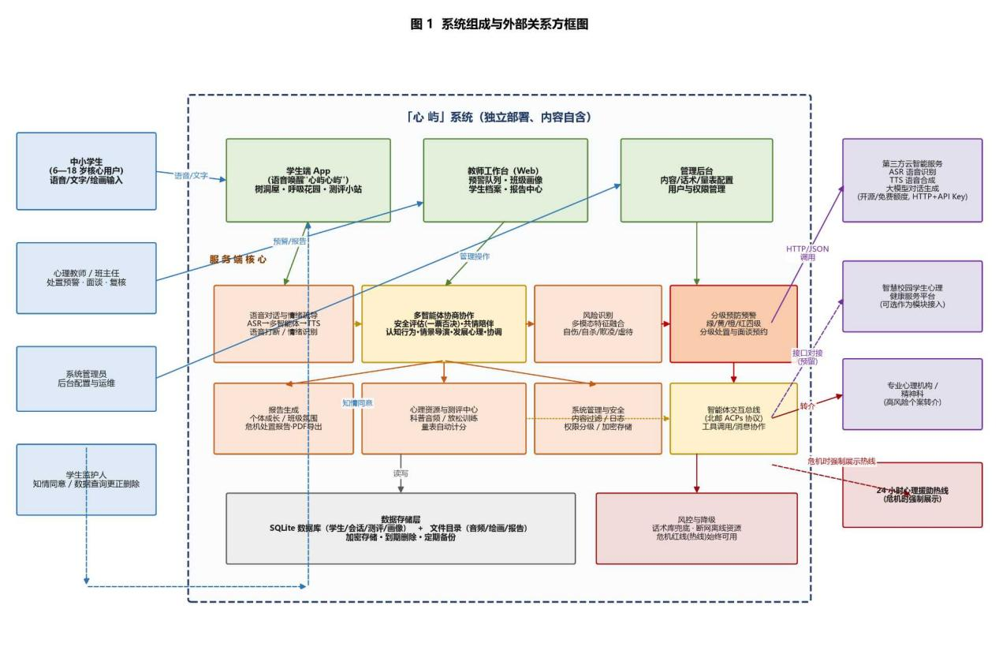

{width="4.069444444444445in"
height="1.1395833333333334in"}

**《程序设计实验》需求分析文档**

{width="1.9111111111111112in"
height="1.9111111111111112in"}

> **题目: 「心屿」------面向中小学生的多智能体心理疏导与情景交互系统**

**班 级 2025219107班**

**学 号 2025211996，**

> **2025212121，**
>
> **2025212021**
>
> **姓 名 彭钰哿，黄文卿，李锦**

**指导教师 许晨**

**2026 年 9 月29日**

# 1、任务概述

**1.1、目标**

（一）项目背景

{width="5.759027777777778in"
height="3.7666666666666666in"}

图 1 系统组成与外部关系方框图

近年来，中小学生心理健康问题逐渐走向低龄化、隐蔽化，学业压力、同伴关系、亲子冲突、校园欺凌等问题在小学高年级至高中阶段普遍存在。传统心理健康工作以普查和面谈为主，存在一些不足：一是师资缺口大，一名心理教师往往对应上千名学生；二是学生大部分情况下不会选择主动求助，问题往往在恶化后才被发现；三是疏导过程缺乏情境，学生听了很多道理，仍不会切实解决。与此同时，《全面加强和改进新时代学生心理健康工作专项行动计划》明确要求健全心理健康预防、预警、干预机制。

（二）应用目标

1\.
低门槛陪伴：为6---18岁中小学生提供以语音对话为主的随时可用的AI心理陪伴与情绪疏导服务，降低求助成本，消除病耻感。

2\.
情景化：让学生在安全的虚拟场景中，以语音与AI多角色实时对话，演练被起外号、考试失利、同伴矛盾、当众发言紧张、亲子沟通、识别校园欺凌等真实困境，实现从"知道"到"做到"的迁移，有效预防心理问题。

3\.
多智能体协作：共情陪伴、认知行为、情景演练、心理学等专业智能体并行产出建议，多智能体协作，基于北邮智能体互联协议（ACPs）规范组织内部讨论、交叉校验与修订后整合为统一回复，安全评估智能体独立优先运行并拥有一票否决权。

4\.
多模态理解：融合文本语义、语音韵律、情景中的行为选择、绘画、沙盘表达，构建心理画像，实现早发现、早预警、分级干预（绿/黄/橙/红四级）。

（三）与其它软件的关系

本软件是一个独立开发的应用系统，全部内容自含，可单独部署运行。同时预留标准接口，必要时可作为"智慧校园学生心理健康服务平台"的智能心理疏导模块接入，与学校心理辅导流程、家长沟通渠道形成互补，但不依赖任何特定第三方心理咨询平台。系统组成与外部关系见图
1。

**1.2、系统（或用户）的特点**

（一）软件特点

1.语音对话优先：以语音为主要输入方式，避免了打字和专业术语，贴合低年龄段学生的表达习惯，支持随时打断，音量变化。

2.分龄适配：按年龄配置语言风格和干预深度。

3.多智能体协商协作：多智能体并行产出建议，协调智能体内部讨论与校验后整合输出，安全评估智能体独立优先运行并一票否决，避免单独智能体角色混乱。

4\.
预防预警一体化：面向全体学生的预防，包括情景演练、情绪素养课、放松训练；面向有风险的学生的预警，包括心理画像、风险分级。

5\. 双端平台：教师工作台与学生端数据互通，帮助老师了解学生心理状态。

6\.
报告自动产出：自动生成个体心理成长报告、班级心理氛围报告、危机事件处置报告。

（二）最终用户特点

1\.
核心用户为6---18岁中小学生：注意力集中时间有限，情绪表达能力不强，需要门槛较低和主动引导的交互设计，小学生以角色陪伴为主，中学生增加深度对话。

2\. 中小学心理教师与班主任：负责处置预警和面谈。

（三）预期使用频度

学生端日均使用10---20分钟、每周2---4次；教师端每个工作日登录1次查看预警队列；报告生成周报每周1次、月报每月1次。

**1.3、假定和约束**

（一）假定

> 1.学生具备基本的语言沟通能力，对语言有障碍的学生，提供文字或绘画输入的方式代

替语音。

> 2.学校配备专职或兼职心理教师，工作日能在10分钟内响应橙色及以上预警。
>
> 3.语音识别、语音合成、大模型等第三方云服务在项目期内稳定可用，并提供合规承诺。

（二）约束

> 1.人力与成本约束：开发团队
> 3人，没有专门采购经费，优先用开源模型和云厂商免费

额度。

> 2.法律与伦理约束：遵守《个人信息保护法》《未成年人保护法》《儿童个人信息网络

保护规定》等要求。本系统只做心理支持，预防与预警，不输出医疗诊断和治疗方案。高

风险个案必须转介专业机构。

> 3.内容约束：干预话术须经有资质的心理教师评估，必要时需要精神科专业人员审核后

才能上线。AI 生成内容全程标注 \"AI 生成\"。

> 4.环境约束：首版以程序、Web 管理端为交付形态。
>
> 5.数据约束：音频、画像等敏感数据默认尽量少采集、加密存储、到期删除，用于模型

训练的数据须经授权。

# 2、需求规定 

**2.1、软件功能说明**

系统功能从输入、处理、输出三方面说明，共7项功能。

1.语音对话与情绪疏导

输入：学生语音或文字。

处理：ASR语音识别→多智能体协商应答→大模型生成共情回应→TTS 语音合成。

输出：语音回应，拟人化角色情感化回应，文字气泡，情绪反馈，可选情绪日记记录，每日小行动建议。

性能容量：语音对话在正常网络下能在 2---3
秒内给出回应，学生可随时打断，情绪识别能基本区分开心、难过、生气、焦虑等主要情绪

2.多智能体协商协作

输入：用户当前输入、用户画像、会话历史、场景上下文、多模态情绪信号与风险等级。

处理：遵循北邮ACPs协议族（如AIP交互协议、ADP发现协议）。安全评估智能体独立优先运行，共情陪伴、认知行为、情景导演、发展心理学、家校上下文等专业智能体并行生成建议，协调智能体组织内部讨论、校验与修订，按分龄策略整合为统一回复，冲突或存疑时以安全评估智能体一票否决并输出兜底话术。

输出：统一回复内容，摘要，后台协作日志。

性能容量：首次回复在2---3秒内给出，支持多类专业智能体并行工作，便于以后扩展新角色。

3.风险识别

输入：文本、绘画或沙盘表达、定期量表。

处理：多模态特征融合，统一的一套风险规则进行识别，能识别出自伤、自杀、欺凌、虐待等危险信号。

输出：风险等级（绿/黄/橙/红）。

性能容量：不漏掉高危情况，误报越少越好，识别到高危风险后能在1分钟内上报。

4.分级预防预警

输入：风险等级，学生画像。

处理：绿色推送情绪素养课程；黄色增加放松训练并匿名化提示教师关注；橙色通知心理教师介入并预约面谈；红色立即中断剧情，展示24小时心理援助热线。

输出：预警等级。

5.报告生成

输入：会话记录、演练数据、量表分数。

处理：报告生成智能体按模板汇总并进行合规校验。

输出：学生个体心理成长报告、班级心理氛围报告、危机事件处置报告，支持PDF导出与在线查看。

性能容量：单份报告生成不超过3分钟，支持批量生成。

6.心理资源与测评中心

输入：按校历触发测评。

处理：音频或动画资源播放，自动计分。

输出：科普音频、呼吸与放松训练、测评结果与建议。

7.系统管理与安全

输入：管理员操作。

处理：内容安全过滤。

输出：异常警告。

**2.2、对功能的一般性规定**

1.界面与交互统一：各功能模块遵循统一设计语言，统一图标、术语与按钮布局，同一语义的操作在各端位置一致。

2.错误处理统一：前端给出统一格式的友好文案和语音播报，禁止向学生暴露技术堆栈信息，所有错误均自动上报日志。

3.危机话术统一：所有涉及自伤、自杀、欺凌、虐待等高危情境的回应话术唯一且经专业审核，任何智能体不得自行改写。

4\. AI透明性：所有AI生成的回应和报告均标注"AI
生成，供参考，不构成诊断结论"。

5.方便无障碍：支持字号调节、语速调节、高对比度。

**2.3、 用户界面**

1.学生端App：主界面为卡通场景"心屿小岛"，岛内设三个入口------树洞屋（语音对话与陪伴）、呼吸花园（放松训练）、测评小站（量表与心理资源）。交互以语音气泡、大按钮为主。按年龄切换文案风格。

2\.
教师工作台：看板式布局，左侧导航为预警队列、班级画像、学生档案、报告中心，预警按红/橙/黄/绿四级排序，整体风格为专业的信息界面。

3\. 管理后台：表格式管理界面。

4\.
风格总要求：各端保持统一的风格，学生端偏活泼沉浸，教师端偏清晰可信，深色模式与护眼模式可选。

**2.4、对性能的一般性规定**

2.4.1、精度

1.语音识别：在安静环境下，普通话语音识别的准确率不低于85%，能把学生说的话基本正确地转成文字，不把声纹用于身份识别。

2.情绪识别：能识别出开心、难过、生气、焦虑等基本情绪，识别结果大致准确。

3.风险分级：能正确识别出带有明显危险信号的语句并给出提醒，尽量避免漏掉高危情况。

4.量表计分：量表题目计分与结果计算正确，与标准评分对照没有计算错误。

5.数值与格式：报告中的统计量保留1位小数，比例用整数百分数表示，时间精确到秒，分数统一为0---100的整数。

6.传输与存储精度：语音和图片在传输、存储过程中尽量保持清晰，不因压缩丢失关键内容。

2.4.2、时间特性要求

1.语音对话响应：从学生说完到系统开始回应，一般在2---3秒内完成，学生可随时打断当前播报。

2.风险提醒：识别到高危风险后，教师端能及时收到提醒。

3.报告生成：生成一份报告在3分钟内完成，批量生成能保证基本可用。

4.系统可用性：系统在演示和测试期间保持稳定运行。

5.会话时长：单次情景会话约10---20分钟，时间过长时系统温和提示休息并自动保存进度，单日使用过久会触发护眼与休息提醒。

2.4.3、灵活性

1.操作方式变化：支持语音、鼠标、触控、文字相互切换，方便不同习惯的学生使用。

2.运行环境变化：程序应在常见电脑环境上正常安装运行，便于在不同教室、不同机器间部署。

3.接口变化：对语音识别、语音合成、对话生成等外部服务做统一封装，便于以后替换实现方式，不影响主程序逻辑。

4.精度与时限变化：量表题目、评分规则、报告模板、风险阈值等作为可配置内容，方便老师根据情况调整。

5.业务变化：对话话术等内容可以单独编辑和增删，新增内容不需要重写整个程序。

2.4.4、输入输出要求

（一）输入

1.音频：支持mp3等常见的语音文件格式，单段音频不超过60秒。

2.文本：支持中文文本输入，单条不超过500字，允许使用表情符号。

3.图片：支持jpg、png等常见图片格式。

4.量表作答：作答采用固定选项。

5.表单数据：学号、班级、姓名等。

（二）输出

1.音频：能合成比较自然的中文语音。

2.文本：输出文本，包含情绪标注和"AI 生成"水印提示。

3.结构化数据：情绪标签、风险等级、评分等用统一格式表示，方便程序处理和记录。

4.报告：报告可导出为PDF，同时提供在线查看版本。

5.控制输出：教师端能收到预警推送。

**2.5、数据管理能力要求**

1.数据规模估算：

（1）会话记录：记录学生与系统的对话内容，按演示规模年新增对话记录不超过数万条、文本数据不超过几百MB。

（2）音频数据：保存学生的语音会话，按演示规模年新增约几十GB。

（3）测评数据：学生每学期做2次左右量表，测评记录与绘画等图片数据量较小。

（4）报告数据：按需生成个体报告和班级报告，报告文件数量有限。

2.存储估算：业务数据用数据库保存，音频、图片等大文件保存在服务器硬盘的固定目录中，定期清理。

3.数据保留与销毁：音频等原始文件默认保存一段时间后删除，只保留转写后的文本，会话文本按需保存。

4.备份与恢复：定期备份数据库和重要文件，程序或服务器出现问题时能从备份恢复，尽量减少数据丢失。

**2.6、故障处理要求**

1.语音服务故障：语音识别或合成出错时，自动重试，仍不可用则降级为文字对话并提示学生，保证还能继续沟通。

2.对话生成服务故障或超时：改用预先写好的话术库兜底，保证系统在故障时也能正常回应学生。

3.网络中断：断网时自动保存会话进度，提示学生稍后重连，断网期间可展示已有的放松音频等离线资源。

4.数据库故障：程序能提示"数据暂时不可用"，尽量不崩溃，教师端降级为只读已有数据，避免误发预警。

5.风险误判：对预警记录可人工抽检和复核，发现识别不准确时调整规则，减少误报漏报。

6.服务整体故障：出现程序崩溃或服务器异常时能快速重启恢复，重要数据不丢失，演示期间出现问题能及时处理。

7.危机红线：任何情况下，一旦识别到自伤、自杀等危险信号，立即展示24小时心理援助热线，这一条无论系统是否故障都必须保证。

**2.7、其他专门要求**

1.安全保密要求：账号分学生、教师、管理员等不同权限，各角色只能访问自己的数据。密码加密保存，重要数据加密存储，关键操作有日志记录。

2.未成年人个人信息保护：使用前获得监护人知情同意，学生数据可查询、可更正、可删除，未经授权不把未成年人数据用于其他用途。

3.伦理与内容安全：明确告知学生是"AI
生成"内容，不输出医疗诊断与治疗建议，测评和风险评估结果只作为参考，不替代专业判断，过滤暴力、自伤、欺凌等敏感内容。

4.易用性要求：新学生能在几分钟内学会使用，提供文字和语音两种使用方式。

5.可维护性与可补充性：程序按模块化组织，话术、量表、报告模板等便于增删改，接口有说明文档，代码有必要的注释和测试。

6.可靠性要求：系统在演示和测试期间稳定运行，高危话术和转介流程反复测试，确保关键时刻可用。

7.运行环境可转换性：程序能在课程演示环境运行，数据和报告导出为通用格式，方便迁移和存档。

# 3、运行环境规定

**3.1、设备**

1.学生端：运行学生端程序的电脑或智能手机。

2.教师端：运行教师端程序的电脑或智能手机。

3.服务器：一台普通服务器或性能较好的电脑，用于存放程序和数据库。

4.网络设备：普通局域网或互联网连接。

**3.2、支撑软件**

1.服务器端操作系统：Windows。

2.开发语言与框架：Python，界面可用简单图形界面或Web页面实现。

3.数据库：SQLite，用于保存学生、会话、测评等数据。语音、图片等文件保存在文件目录中。

4.智能功能支撑：语音识别、语音合成、对话生成采用开源库或免费接口，或者用本地简单实现代替。

5.测试支持：使用简单的单元测试工具和手动测试，验证主要功能。

6.工程支撑：使用Git进行版本管理，记录开发和修改过程。

**3.3、接口**

1.与外部智能服务接口：按智能体工具调用规范，通过HTTP请求语音识别、语音合成等外部服务；请求带API密钥，供服务器核验身份后调用，数据采用
JSON格式交互。

2.与测评数据接口：程序内部模块之间用函数或简单接口交换量表版本、作答记录与评分结果。

3.内部接口：程序内部各模块通过函数调用或简单的消息机制协作，对外只暴露需要的接口。

4.智能体交互：符合北邮智能体互联协议ACPs。系统内部各专业智能体（共情陪伴、认知行为、情景导演等）与协调智能体之间的通信、任务分解、群组协作与消息路由，全面遵循北邮智能体互联协议（ACPs）标准。注册与发现（ARP/ADP）：支持各专业智能体能力的动态注册与分布式寻址；交互与协作（AIP）：规定多智能体并行讨论、交叉校验及安全评估智能体"一票否决"中断指令的报文格式与传输规范。

**3.4、控制**

1.运行控制方法：学生端用图形界面+语音唤醒词（"心屿心屿"）启动和交互.管理后台控制各功能运行。

2.控制信号来源：

（1）用户交互：鼠标、触控点击、语音指令、教师端操作按钮。

（2）风险规则：识别到危险信号达到阈值时自动触发预警、中断剧情。

# 4、尚需解决的问题

1.情景"趣味性"与"专业性"的平衡尚需验证：分支剧情设计、成长评分标准还需要和老师一起调整，并通过小规模测试看效果。

2.多模态识别的使用边界待明确：摄像头表情识别、绘画、沙盘判断在未成年人场景下的授权方式、误识别责任与数据保存期限，需经校方和伦理审查后再决定是否纳入首版。

3.风险识别阈值与处置流程需专业指导：漏报误报的容忍程度、人工接管的响应时限。

4.对话生成不准确、不当回复的控制策略需验证：包括什么话该拒答、话术模板约束，以及网络差时的降级方案。

5.未成年人数据合规路径待完成：是否需要伦理审查、个人信息保护评估等申报流程，与教育主管部门的备案要求尚未明确。

6.试点与推广机制待建立：如何引导学生持续使用而不产生依赖、如何评价应用效果，尚需在需求评审阶段与校方共同确定。
